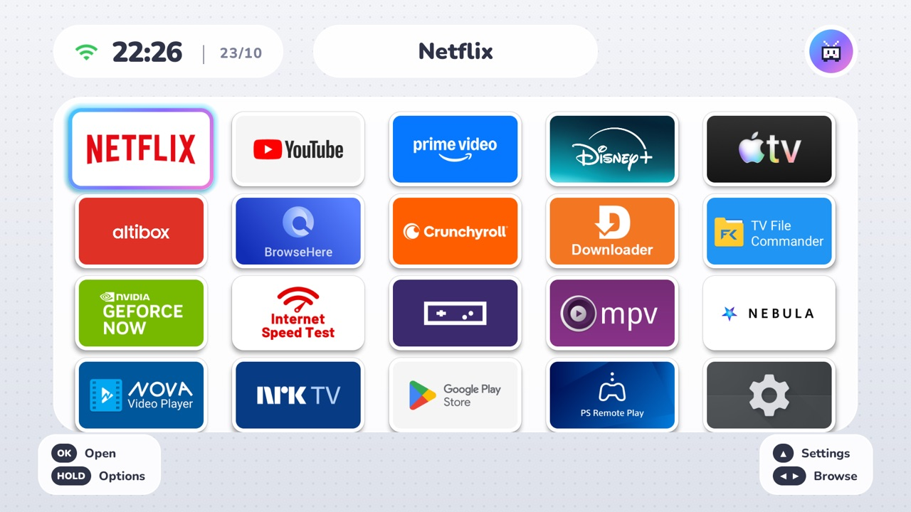
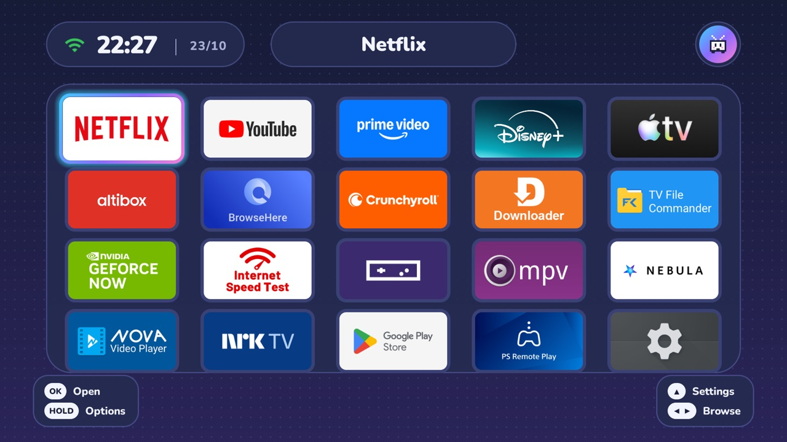

# iiSU skin

This fork of [cleanyourtv](https://github.com/Gathin23/cleanyourtv) adds an **iiSU-style look** to its launcher:
the console-menu style of the [iiSU](https://github.com/iisu-network/iiSU) handheld frontend, and of the
Wii U and 3DS menus it borrows from, on an Android TV or Google TV. Everything else in cleanyourtv (the
debloat, the safety rules, the one-line restore) is unchanged.

| iiSU light | iiSU dark |
|---|---|
|  |  |

Both screenshots are from a Chromecast with Google TV HD (Android 14).

## What you get

- A pale (or navy) dotted backdrop, with every app in one big frosted panel that scrolls, and white bezels round
  the tiles.
- A cyan-to-violet focus ring, and a title pill at the top that names the focused app.
- A status pill with the network icon (green while online), the time and the date.
- An avatar pill with your name and picture. It is also the Settings button: OK opens the TV's settings, and holding
  OK opens the launcher menu.
- Button hints in the bottom corners, and the Settings, Inputs and tile menus restyled to match.
- [Nunito](https://fonts.google.com/specimen/Nunito), a rounded heavy font (SIL Open Font License), and two soft UI sounds: a tick
  when you move and a chime when you open something.
- A screensaver that plays your own GIF (a Mii dancing, say) on the skin's backdrop, with the time in a corner.
- **Launcher settings → Look**: Classic, iiSU light or iiSU dark, switchable with the remote.

Not affiliated with iiSU or Nintendo. None of iiSU's art, fonts, sounds or code are used: iiSU is closed source,
so this is a look recreated from scratch. The sounds were synthesized for this fork, and the default avatar is an
original pixel-art TV.

## Install it with Claude Code (or another coding agent)

You need a computer on the same Wi-Fi as the TV, with ADB debugging turned on on the TV (cleanyourtv's
[README](../README.md) explains how). Then:

```bash
git clone https://github.com/janathan821/cleanyourtv-iisu.git
cd cleanyourtv-iisu
claude
```

And paste:

```text
Read AGENTS.md and then PROMPT.md, and clean up my TV at <tv ip> by following PROMPT.md exactly. Once the
launcher is installed and confirmed as Home, give it the iiSU look by pushing themes/iisu-dark with
tools/theme.sh (themes/iisu-light if I ask for light). If I give you a name, a picture or a GIF, follow
docs/iisu.md's "Make it yours" section to make my own copy of the theme in work/themes/my-iisu, and push that
instead.
```

Already ran cleanyourtv on this TV? Then skip the cleanup and ask only for the last part: rebuild the launcher
from this fork with `launcher/build-and-install.sh` and push the theme.

## Install it yourself

The launcher builds the same way as upstream (JDK 17 and the Android SDK; see the README's launcher section):

```bash
TV_HOST=192.168.1.50 launcher/build-and-install.sh     # build this fork's launcher and make it Home
TV_HOST=192.168.1.50 tools/theme.sh themes/iisu-dark   # or themes/iisu-light
```

On Windows, `launcher\build-and-install.ps1` and `tools\theme.ps1` do the same. Pass the same extras to
`build-and-install` that you used before (`INPUT_KEY_SERVICE=1` for a remapped remote button, and so on).

## Make it yours

Copy a theme into `work/` (git ignores it, so your picture and name stay on your computer) and add your own files:

```bash
mkdir -p work/themes && cp -R themes/iisu-dark work/themes/my-iisu
```

| What | How |
|---|---|
| **Your name** in the avatar pill | `"greeting_name": "Sam"` in `config.json` |
| **Your picture** in the avatar pill | A square `avatar.png` in the folder, about 192×192, ideally with a transparent background. It is cut to a circle on the cyan-violet gradient. A Mii render cropped to the head works well. |
| **The screensaver animation** | A `screensaver.gif` in the folder. A transparent background looks best, since it sits on the skin's dotted backdrop. A 50 fps GIF keeps a weak TV's CPU busy: `python3 tools/gif_halve.py in.gif screensaver.gif` keeps every other frame (same loop length, about half the work). |
| **Your dock** (the first tiles) | `dock_apps`, as in any theme |

Then push it: `TV_HOST=192.168.1.50 tools/theme.sh work/themes/my-iisu`. The screensaver shows when the TV's own
screensaver starts (Settings → System → Ambient mode / Screen saver), or after `home_idle_clock_minutes` on Home.

## Going back

- **Launcher settings → Look → Classic** (hold the avatar pill, then Launcher settings).
- Or push any other theme, or reset: `tools/theme.sh --reset`.
- To uninstall everything, cleanyourtv's restore works as usual (`tools/restore.sh`).

## How heavy is it?

Measured on a Chromecast with Google TV HD:

| Situation | Launcher CPU |
|---|---|
| Sitting on Home | about 0 to 1%: nothing animates while Home is still |
| Moving between tiles | about 45 to 50% of one core during the moves (the chip has four) |
| Screensaver with a 25 fps GIF | about 40% of one core while it shows (about 60% at 50 fps) |
| In another app | about 0% |

Memory is about 100 MB, half of it graphics. The launcher still has no internet permission, so it cannot show ads
or send anything anywhere.

## For tinkerers

- The whole skin is one switch, `iisu_skin` (`light`, `dark` or empty), described in
  [themes/README.md](../themes/README.md). Off, the launcher is upstream's.
- The code is in `launcher/app/src/main/java/com/gathin/tvhome/`: `Iisu.java` (colours, backdrop, pills, avatar,
  sounds), `IisuScreensaver.java`, and small hooks in `MainActivity`, `AppAdapter`, `GlassView`, `Config`,
  `ClockDream` and `ClockActivity`.
- The APK is about 570 KB (Nunito and the sounds), so this fork's CI size gate is 640 KB instead of 480 KB.
- To follow upstream: `git remote add upstream https://github.com/Gathin23/cleanyourtv.git && git pull upstream main`.
